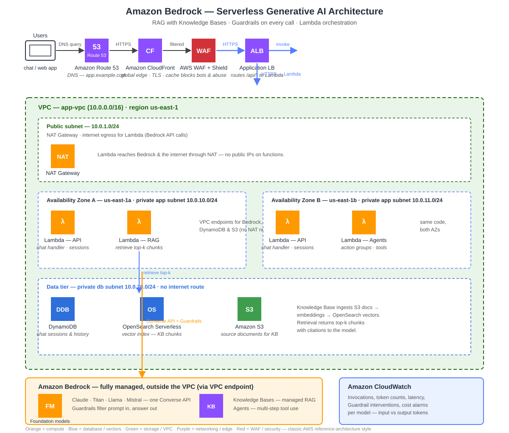

# Amazon Bedrock — Generative AI Without Managing Models

[](https://aws.amazon.com/bedrock/)
[](https://aws.amazon.com/bedrock/)
[](LICENSE)
[](#)

> **TL;DR:** Amazon Bedrock gives you **serverless access to foundation models** (Claude, Titan, Llama, Mistral, Stable Diffusion and more) through one API — no GPUs to buy, no model servers to run, no training pipelines to babysit. Add **Knowledge Bases** for RAG, **Guardrails** for safety, and **Agents** for multi-step tasks, and you have a production GenAI app on fully managed AWS building blocks.

---

## What Bedrock actually gives you

| Piece | What it does | Why it matters |
|---|---|---|
| **Foundation models** | One API for models from Anthropic, Meta, Mistral, Amazon, Stability AI, Cohere | Swap models with a single parameter — no re-architecture when a better model ships |
| **InvokeModel / Converse API** | Text, image and tool-use calls, streaming or batch | The Converse API normalises messages, tools and documents across providers |
| **Knowledge Bases (RAG)** | Ingests your docs into a vector store (OpenSearch, Aurora, S3 Vectors) | Answers grounded in *your* data, with citations — no fine-tuning needed |
| **Guardrails** | Content filters, PII redaction, topic deny-lists, word filters | Policy enforced at the API layer, before and after the model runs |
| **Agents** | Multi-step reasoning with action groups (Lambda functions) | The model can call your APIs, query databases, then summarise the result |
| **Model evaluation** | Automatic (ROUGE, BLEU) and human evaluation jobs | Measure quality before you ship, not after users complain |
| **Provisioned Throughput** | Reserved capacity for a model, per model unit | Predictable latency and throughput for production traffic |

The mental model: **Bedrock is a model vending machine, not a model kitchen.** You don't cook the model — you pick one off the shelf, pay per token, and spend your engineering time on the app around it: your data, your guardrails, your tools.

---

## Architecture



Traffic flow: **User → Route 53 → CloudFront + WAF → Application Load Balancer → Lambda (API + orchestration) → Amazon Bedrock (foundation model) → Knowledge Base (S3 docs + OpenSearch Serverless vectors)**, with **Guardrails** filtering every prompt and response, **DynamoDB** for sessions, and **CloudWatch** for token and latency metrics.

Key design decisions in the diagram:

- **Lambda is the only compute** — the API, the RAG retrieval and the agent action groups are all Lambda functions. No servers, no scaling policy to tune.
- **Guardrails sit on both sides** — one Guardrail filters the incoming prompt (PII, blocked topics), the same Guardrail filters the model's answer before it reaches the user.
- **RAG before generation** — the retrieval Lambda queries the Knowledge Base first; only the top-k chunks plus the user question reach the model. The model never sees your whole document store.
- **Two AZs for everything stateful** — OpenSearch Serverless collections and DynamoDB tables span AZ-a and AZ-b, so a single AZ failure doesn't take the app down.

---

## Bedrock vs the alternatives

| Option | Model hosting | Data grounding | Safety controls | Best for |
|---|---|---|---|---|
| **Amazon Bedrock** | ✅ Fully managed, serverless | Knowledge Bases (managed RAG) | Guardrails built in | AWS-native production apps |
| Self-hosted open models (EC2 / SageMaker) | You run the GPUs | You build the pipeline | You build the filters | Full control, custom fine-tunes |
| Direct provider API (e.g. Anthropic) | ✅ Managed | You build RAG yourself | Provider-side only | Single-model apps, non-AWS stacks |
| Amazon SageMaker JumpStart | Managed endpoints | You wire it up | You build it | Teams already deep in SageMaker |
| Amazon Q | ✅ Managed, chat-first | Connectors included | Enterprise controls | Internal employee assistant, fast |

**Rule of thumb:** if your app lives on AWS and you want GenAI in weeks, not quarters, Bedrock is the shortest path. Reach for self-hosting only when you need a custom fine-tune or a model Bedrock doesn't offer.

---

## Quickstart

### 1. Enable model access (one time, in the console)

Bedrock → Model access → enable the models you need (e.g. Anthropic Claude, Amazon Titan). Some models require a use-case form — approval is usually same-day.

### 2. Call a model with the Converse API

```bash
pip install boto3
python bedrock_demo.py --ask "Explain VPC peering in one paragraph"
```

### 3. Ask a question grounded in your own documents

```bash
# Ingest docs from S3 into a Knowledge Base, then ask against it
python bedrock_demo.py --kb kb-ABC123XYZ --ask "What is our refund policy?"
```

### 4. Check what it costs before you scale

```bash
python bedrock_demo.py --estimate --input-tokens 1000000 --output-tokens 200000
```

---

## Cost — the part people forget

| Item | Price (approx.) | Notes |
|---|---|---|
| On-demand inference | **$0.00025–$0.015 / 1K input tokens** | Varies wildly by model — Claude Opus costs ~60× Titan Text Lite |
| On-demand output tokens | **$0.00125–$0.075 / 1K tokens** | Output tokens are the expensive side; keep answers concise |
| Knowledge Bases | Storage + OpenSearch Serverless OCUs | Vector storage is the hidden cost — prune stale chunks |
| Guardrails | **$0.00 / 1K text units (first tier)** | Cheap insurance; the expensive mistake is skipping it |
| Provisioned Throughput | **Per model unit / hour** | Only worth it at steady, high volume — measure first |

**Cost trap:** RAG retrieval runs *before* every generation, so a sloppy prompt that retrieves 20 chunks of 2,000 tokens each burns 40K input tokens per question. Tune `top-k` and chunk size in `bedrock_demo.py` — smaller, better chunks beat bigger, noisier ones.

---

## Production checklist

- [ ] Model access enabled in **every region you deploy to** — access is per region.
- [ ] Guardrails on **both** input and output, with PII redaction for regulated data.
- [ ] Knowledge Base chunks **tested for retrieval quality** — a bad chunk is worse than no chunk.
- [ ] `top-k` and chunk size tuned; retrieval metrics logged to CloudWatch.
- [ ] Streaming enabled for chat UX — users read as tokens arrive, instead of waiting.
- [ ] Token usage and cost alarms per model (input vs output separately).
- [ ] Prompt templates versioned — a changed system prompt is a deployment, treat it like one.
- [ ] Fallback model configured — if your primary model throttles, degrade gracefully.

---

## Quiz teaser

Can you explain why RAG beats fine-tuning for a company whose documents change weekly — and what Guardrails actually filter? Test yourself in [quiz.md](quiz.md) — 5 questions, answers collapsed.

---

## Further reading

- [Amazon Bedrock docs](https://docs.aws.amazon.com/bedrock/latest/userguide/what-is-bedrock.html)
- [Converse API](https://docs.aws.amazon.com/bedrock/latest/userguide/converse.html)
- [Knowledge Bases for RAG](https://docs.aws.amazon.com/bedrock/latest/userguide/knowledge-base.html)
- [Guardrails](https://docs.aws.amazon.com/bedrock/latest/userguide/guardrails.html)
